# Radio Sight Architecture

Radio Sight keeps sensing decisions, training, and explanation on the Arduino UNO Q. The board and Pi A sit together on the desk; Pi B sits across one sensing spot at desk height. Wi-Fi from Pi A to Pi B is the main sensor and dead-zone link. Bluetooth from Pi B to the board gives a second opinion. Both Pis run no model. A laptop browser shows the local interface.

```mermaid
flowchart LR
    subgraph PI["Pi A — beside the UNO Q"]
        PI_RADIO["Pi A radio node<br/>Bluetooth readings and Ethernet route"]
        HOTSPOT["Private hotspot<br/>sensing and light browser traffic"]
    end

    PIB["Pi B — across the sensing spot<br/>Wi-Fi RSSI reader and Bluetooth radio"]

    SCREEN["Laptop browser<br/>local demo screen"]

    subgraph UNO["Arduino UNO Q — Dragonwing CPU"]
        WIFI["Wi-Fi RSSI reader"]
        BLE["Bluetooth HCI reader"]
        TEACHER["Camera teacher<br/>setup labels only"]
        CAMWATCH["Camera watcher<br/>on / off / stalled"]
        BUS["Message bus<br/>UDP 0.0.0.0:5600"]

        subgraph BRAIN["Brain"]
            FEATURES["Windowing and features"]
            HEALTH["Link health"]
            MODEL["Presence / object / motion model<br/>one spot from the deployed layout"]
            XRAY["Radio X-ray"]
            CHECKIN["Check-in rule<br/>lean aside"]
            ALERT["No-movement alert"]
            ADVISOR["Router advisor"]
            TAMPER["Tamper rule<br/>silent device while armed"]
        end

        NARRATOR["Narrator"]
        STORE["store/ — local summaries and events"]
        AGENT["agent/ — Ask the room"]
        REPLAY["Recorded replay"]
        REPORT["Incident report"]
        LLAMA["llama-server<br/>http://127.0.0.1:8091"]
        SERVE["Web server<br/>http://192.168.77.2:8080"]
        BRIDGE["Host Bridge<br/>arduino package"]
        LED["UNO Q microcontroller<br/>LED grid"]
    end

    PI_RADIO -->|"Bluetooth rssi over Ethernet<br/>192.168.77.2:5600"| BUS
    HOTSPOT -->|"Wi-Fi across the gap<br/>main presence and dead-zone sensor"| PIB
    PIB -->|"rssi via Pi A hotspot and Ethernet<br/>192.168.77.2:5600"| BUS
    PIB -.->|"Bluetooth second opinion"| BLE
    HOTSPOT -->|"laptop connection"| SCREEN
    WIFI -->|"rssi<br/>127.0.0.1:5600"| BUS
    BLE -->|"rssi<br/>127.0.0.1:5600"| BUS
    TEACHER -->|"label<br/>msgpack-rpc-router:5600"| BUS
    CAMWATCH -->|"cam<br/>127.0.0.1:5600"| BUS

    BUS -->|"forwarded UDP<br/>127.0.0.1:5601"| FEATURES
    FEATURES --> HEALTH
    HEALTH --> MODEL
    MODEL --> XRAY
    MODEL --> CHECKIN
    MODEL --> ALERT
    HEALTH --> TAMPER
    XRAY --> ADVISOR

    MODEL -->|"state and event<br/>ws://192.168.77.2:8765/ws"| SCREEN
    XRAY -->|"state"| SCREEN
    HEALTH -->|"state"| SCREEN
    CHECKIN -->|"state and event"| SCREEN
    ALERT -->|"state and event"| SCREEN
    TAMPER -->|"named device event"| SCREEN
    ADVISOR -->|"state and event"| SCREEN
    SERVE -->|"page and proof via Pi route<br/>and Ethernet cable"| SCREEN
    SCREEN -->|"cmd over the same WebSocket"| MODEL

    MODEL -->|"events"| NARRATOR
    MODEL -->|"state and events over local WebSocket"| STORE
    STORE -->|"saved rows"| AGENT
    STORE --> REPLAY
    STORE --> REPORT
    AGENT -->|"POST /ask"| SERVE
    REPLAY -->|"GET /history"| SERVE
    REPORT -->|"GET /report"| SERVE
    NARRATOR -->|"prompt"| LLAMA
    LLAMA -->|"generated sentence"| NARRATOR
    NARRATOR -->|"narration<br/>127.0.0.1:5600"| BUS
    MODEL -->|"zone and alert state"| BRIDGE
    BRIDGE -->|"Arduino Router Bridge"| LED

    %% Shared tokens from web/src/room/palette.ts: BG, FLOOR, EDGE, TEXT, LINK.
    classDef source fill:#1A1D21,stroke:#858E99,color:#E6E8EB;
    classDef core fill:#1A1D21,stroke:#353B43,color:#E6E8EB;
    classDef output fill:#111316,stroke:#858E99,color:#E6E8EB;
    class PI_RADIO,PIB,HOTSPOT,WIFI,BLE,TEACHER,CAMWATCH source;
    class BUS,FEATURES,HEALTH,MODEL,XRAY,CHECKIN,ALERT,ADVISOR,TAMPER,NARRATOR,LLAMA,STORE,AGENT core;
    class SCREEN,SERVE,BRIDGE,LED,REPLAY,REPORT output;
```

## Inputs and bus

The UNO Q's Wi-Fi and Bluetooth readers send `rssi` messages to the local bus at `127.0.0.1:5600`. Pi A sends readings over the direct Ethernet cable to `192.168.77.2:5600`; Pi B sends over the hotspot through Pi A to that same endpoint. The Wi-Fi path across the gap supplies the primary presence evidence, while the short desk Wi-Fi path cannot measure that spot. The App Lab camera teacher reaches the bus through `msgpack-rpc-router:5600`. Camera state and setup labels use the same contract-v2 envelope as the radio data.

The bus listens on `UDP 0.0.0.0:5600`, adds board receive time, records sequence gaps, and forwards the agreed input stream to the brain at `UDP 127.0.0.1:5601`. Window joins and proof timing use that board receive time so every producer shares one clock at the decision boundary.

## Brain and advisor

The brain builds signal windows, checks link health, and runs the trained presence, object, and motion model for the configured spot. It also produces the radio X-ray, applies the lean-aside check-in and no-movement alert rules, and contains the router advisor. The advisor reads persistent change on the same Wi-Fi link across the gap and configured router spots; it does not bypass the brain or run on a Pi. Positions and sensing links come from the deployed `radio/nodes.json`.

If a required classifier link is blind, the brain sends a blind health state and no prediction. The screen must not translate missing or unhealthy input into an empty room.

## Screen, narration, and LED grid

The `store/` service keeps local state summaries and events on the UNO Q. `agent/` answers Ask the room questions and builds incident reports from those records; the web server also serves history for replay. Tamper reports a silent device while armed. Missing history stays unknown, and replay is always labelled as recorded rather than live.

The brain publishes contract-v2 `state` and `event` messages on `ws://192.168.77.2:8765/ws`. The laptop joins the Pi hotspot and opens `http://192.168.77.2:8080/?src=ws`; the Pi routes the page, proof data, state, and commands over its direct Ethernet cable to the board. Only light browser traffic uses the hotspot during a demo or recording.

Brain events also feed the on-board narrator. For generated explanations, `python -m narrator.narrate` calls the local `llama-server` at `http://127.0.0.1:8091`; the template path stays on the same board when generation is unavailable. The narrator returns a `narration` message to the local bus at `127.0.0.1:5600`, so both explanation paths rejoin the same ordered state path.

For the physical display, the board host calls the `arduino` Bridge package with zone and alert state. The Arduino Router Bridge carries that small command to the UNO Q microcontroller, which draws it on the LED grid; the Pi is not in that path.

## Privacy and deployment boundaries

- All trained models and learned decisions run on the UNO Q's Dragonwing CPU.
- The camera teacher is for setup labels only and saves no image or video.
- The Pi provides network and radio functions, routes the laptop browser to the board, and runs no model.
- Runtime services bind only to the local addresses defined in `CONTRACTS.md`; the system uses its own network, not venue Wi-Fi or a cloud service.
