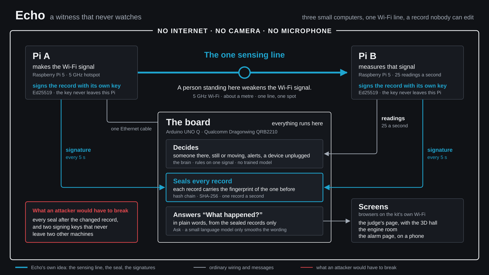
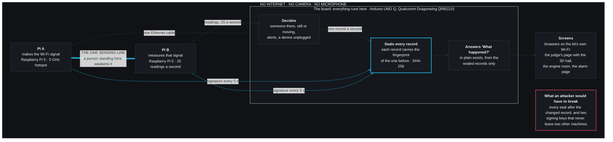
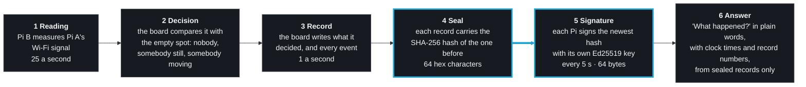

# Echo: how it is built

Echo is a witness that never watches. Three small computers on two desks sense one spot with a Wi-Fi signal, keep a record nobody can edit, and answer "What happened?" from that record. There is no camera and no microphone on the kit, and nothing goes to the internet while it runs.

## The whole system

The same picture as a diagram GitHub draws:

Blue is what is Echo's own idea: the sensing line, the seal and the signatures. Red is what an attacker would have to break. Everything else is ordinary wiring.

## The data path, in order

| Step | Where it runs | How often, how big |
|---|---|---|
| 1 Reading | Pi B | 25 readings a second of one 5 GHz line, sent to the board as small UDP messages |
| 2 Decision | the board | follows every reading; the screens get the state about 10 times a second |
| 3 Record | the board | one summary a second, plus one record for every event |
| 4 Seal | the board | one SHA-256 hash for each record (64 hex characters), made from the record and the hash before it |
| 5 Signature | Pi A and Pi B | every 5 s each Pi signs the newest hash; an Ed25519 signature is 64 bytes |
| 6 Answer | the board | built when someone asks, from the sealed records in the stretch asked about |

## How each part works

Short enough to read aloud.

- **Pi A (a Raspberry Pi 5).** It is a Wi-Fi hotspot, like the access point a building already has. Its signal is the thing Echo senses with. Pi A stays beside the cabled hub that joins it to the board.
- **Pi B (a second Raspberry Pi 5).** It sits about a metre from Pi A, at desk height, and measures how strong Pi A's signal is 25 times a second. It sends each reading to the board over that same hotspot.
- **The sensing line.** A human body between the two Pis absorbs some of the 5 GHz signal, so the reading drops while someone stands there. It is one line and one spot.
- **The board (an Arduino UNO Q, with the Qualcomm Dragonwing QRB2210).** Everything that thinks runs here: the message bus, the decision, the record, the web pages and the answers. The Pis run no model.
- **The decision (the brain).** After a short baseline with the spot empty, the board compares every reading with that empty level. A drop that holds is read as somebody there; how steady it is says still or moving. From that it raises the no-movement alert, raises an intrusion when the space is armed, and notices when one of its own devices is unplugged.
- **The record (the store).** Once a second, and at every event, the board writes down what it decided in one file that stays on the board. It holds decisions, not radio readings.
- **The seal (a hash chain, SHA-256).** Every record carries the fingerprint of the record before it. Change one record and every seal after it stops matching, and the board can name the record that was changed.
- **The signatures (the witnesses, Ed25519).** Every 5 seconds the board says where the record stands, and each Pi signs that with its own key, which never leaves that Pi. The board checks each signature and stores it in the record. If a witness goes silent, the record keeps counting and notes the gap.
- **The answer (Ask).** "What happened?" is answered in plain words from the sealed records only: a timeline with clock times, the steps it took and the record numbers it used. It checks the seals over those records first, and it never says who anyone is.
- **The small language model (Qwen2.5 0.5B, on the board).** It may smooth the wording of a sentence, and for an unusual question it may pick which look-up to run. Every fact, time and number comes from a record; if the model changes one, its text is thrown away.
- **The screens.** They are web pages the board serves to browsers on the kit's own Wi-Fi: the judge's page with a 3D model of the hall, the engine room (the three devices, the record counting up, the signatures arriving and a prove-it check), and the alarm page on a phone.
- **The one Ethernet cable.** It joins Pi A and the board. Pi A passes Pi B's readings and the screens' pages along it, so they do not depend on the board's own Wi-Fi.

## What it does not do

> - It does not know **who** a person is.
> - It does not know **where** in a room a person is. It senses one spot between two devices about a metre apart.
> - It does not make a picture of anything, and it does not count people.
> - It has **no camera and no microphone**, and it sends nothing to the internet while it runs.
> - A bag that blocks the line as much as a body reads as a person standing still.
> - A person needs a few seconds on the line. A walk straight through is not reliably seen.
> - It has not been tested through a wall.
> - It is a prototype built in 24 hours and tested with one person on one night. What is measured is in [PROOF.md](../PROOF.md).

## Where to look in the code

| Part | Folder | Runs on |
|---|---|---|
| Wi-Fi signal reader | `radio/wifi_rssi.py` | Pi B |
| Message bus | `bus/` | the board |
| The decision | `brain/` | the board |
| The record and its seals | `store/` | the board |
| Checking seals and signatures | `board/chain.py`, inside the web server `board/serve.py` | the board |
| Signing | `pi/witness.py` | Pi A and Pi B |
| Ask | `agent/` | the board |
| Wording | `narrator/` | the board |
| Screens | `web/` (the engine room is `web/src/engine/`) | a browser |

Addresses, ports and which message goes where: [network.md](network.md). Message formats: [CONTRACTS.md](../CONTRACTS.md), section 13 for the sealed record and its witnesses.
