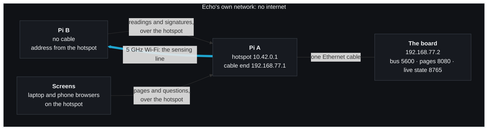

# How Echo connects

Echo keeps all of its traffic on its own kit. The board runs the message bus, the decision, the sealed record, the web pages and the answers. Pi A is the hotspot. Pi B measures the hotspot's signal. Neither Pi runs a model, and nothing needs the internet while it runs. The picture of the whole system is in [architecture.md](architecture.md).

## Two local paths

- **One Ethernet cable**, a direct Ethernet cable from Pi A at `192.168.77.1` to the board at `192.168.77.2`. It carries everything Pi A passes on from the hotspot: Pi B's readings, both Pis' signatures, and the pages and questions of the screens.
- **A 5 GHz Wi-Fi hotspot on Pi A**, at `10.42.0.1`. Its signal across the gap to Pi B is the sensor. Pi B, the board's own Wi-Fi and the screens join it and get their addresses from it. Pi B has no cable, and no address for it is written into the repository.

Pi A forwards hotspot traffic onto the cable, so on the board everything from the hotspot arrives from `192.168.77.1`.

Do not copy files or bundles over the hotspot during a demo or a recording. The hotspot is also the sensor, and heavy traffic on it can starve the readings.

## Which message goes where

| What | From | To | How | How often |
|---|---|---|---|---|
| Signal reading (`rssi`) | Pi B | the bus, `192.168.77.2:5600` | UDP over the hotspot, then Pi A puts it on the cable | 25 a second |
| Every bus message, stamped with the board's time | the bus | the brain, `127.0.0.1:5601` | UDP inside the board | as it arrives |
| State and events | the brain | the screens, `ws://192.168.77.2:8765/ws` | WebSocket, through Pi A | about 10 a second |
| State and events | the brain | the store, `ws://127.0.0.1:8765/ws` | WebSocket inside the board | the store keeps one summary a second and every event |
| Where the record stands (`chain_head`) | the web server | the bus, `127.0.0.1:5600`, which sends it on to each Pi | UDP; the reply goes back on the socket the Pi sent from | every 5 s |
| "I am here" (`chain_sub`) | each Pi | the bus, `192.168.77.2:5600` | UDP; it keeps the path open for Pi B behind the hotspot | every 5 s |
| Signature (`chain_witness`) | each Pi | the bus, `192.168.77.2:5600`, then the web server at `127.0.0.1:5602` | UDP; the web server checks it and stores it in the record | every 5 s from each Pi |
| Pages, Ask, history, report and the sealed record | a browser | the web server, `http://192.168.77.2:8080` | HTTP, through Pi A | when someone looks or asks |
| Wording | Ask and the narrator | the language model, `http://127.0.0.1:8091` | HTTP inside the board; never open to the network | when a sentence is smoothed |

The readers for Bluetooth and for the short Wi-Fi line between Pi A and the board are still in the repository and may still send readings to the bus. Their lines are drawn at most. They decide nothing.

## The pages

A laptop or a phone joins Pi A's hotspot and opens the board's web server. Pi A routes HTTP port `8080` and WebSocket port `8765` over the Ethernet cable to the board.

| Page | Address | What it is |
|---|---|---|
| The judge's page | `http://192.168.77.2:8080/` | the 3D hall, the person as a figure, Ask |
| The engine room | `http://192.168.77.2:8080/engine/` | the three devices, the record counting up, the signatures arriving, the prove-it check |
| The alarm page | `http://192.168.77.2:8080/phone/` | the alert, on a phone |

The web server answers Ask, the history, the report and the sealed record only to the board itself, `192.168.77.0/24` and `10.42.0.0/24`.

## Service map

| Service | Runs on | Local endpoint | Role |
|---|---|---|---|
| Message bus | Board | UDP `0.0.0.0:5600` | Receives readings, signatures and commands; adds the board's time |
| Decision input | Board | UDP `127.0.0.1:5601` | Carries bus messages to the brain |
| Signature input | Board | UDP `127.0.0.1:5602` | Carries each Pi's signature from the bus to the web server |
| Live state | Board | WebSocket `192.168.77.2:8765/ws` | Sends state and events to the screens and to the store |
| Web server | Board | HTTP `192.168.77.2:8080` | Serves the pages, Ask (`/ask`), `/history`, `/report` and the sealed record (`/chain`, `/chain/verify`, `/chain/tail`, `/chain/prove`) |
| Store | Board | one file on the board | Writes every record and seals it |
| Language model | Board | HTTP `127.0.0.1:8091` | Smooths wording; never reachable from the network |
| Signal reader | Pi B | UDP to `192.168.77.2:5600` through Pi A | Sends the readings of the sensing line |
| Witness | Pi A and Pi B | UDP to `192.168.77.2:5600` | Signs where the record stands with that Pi's own key |
| Screens | Laptop, phone | Browser on Pi A's hotspot | Show the board's pages |

## Bring-up

1. On Pi A, run `sudo bash pi/eth.sh` to configure its end of the Ethernet cable.
2. On the board, run `sudo bash board/eth.sh` to configure the board's end and confirm Pi A is reachable.
3. On Pi A, run `sudo bash pi/ap.sh` to start the hotspot.
4. On the board, run `sudo bash radio/wifi_join.sh` to join the hotspot with power saving off.
5. Join Pi B to the hotspot. Start `python -m pi.radio_node --node pi5b` and `WIFI_LINK=pi5>pi5b:wifi python -m radio.wifi_rssi`, both with `BUS_HOST=192.168.77.2`.
6. On each Pi, once: `python3 -m pi.witness --init` makes that Pi's key pair and prints its public key. Enrol the public key on the board. The private key never leaves the Pi.
7. Join the laptop and the phone to the hotspot and open the pages.
8. Take a baseline with the spot empty before anyone steps in.

The scripts read the hotspot's name and password from the ignored `.env` file. Never put those values in a command, an issue or a document.

## What leaves the kit

Nothing has to. No part of the running system calls a cloud service, and the board has no internet once it is on the hotspot. The board also counts the bytes it sends to any address outside its own two networks and reports the count at `/privacy`.

There is no camera and no microphone in the demo. The record holds decisions and events only: no radio readings, no images and no sound.
