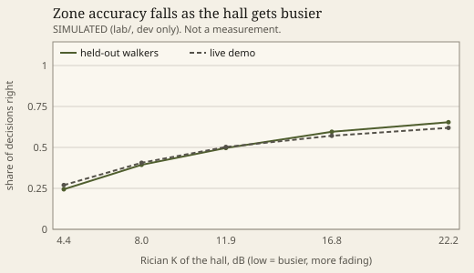
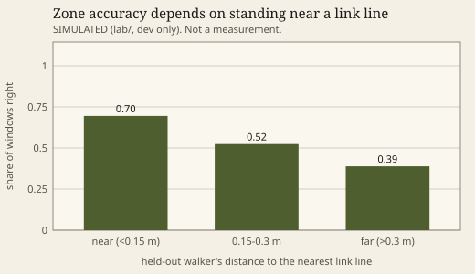
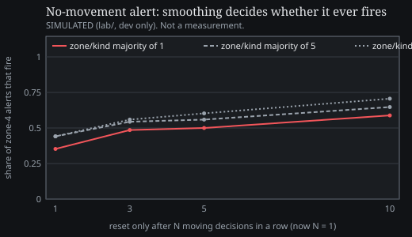
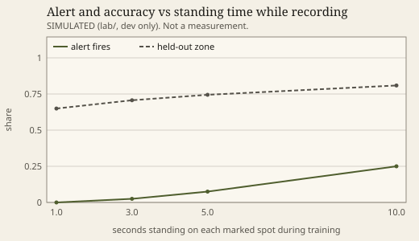
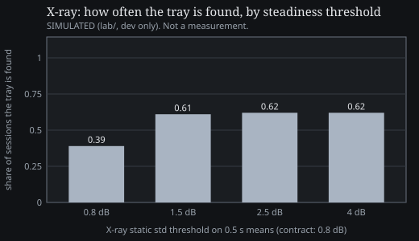
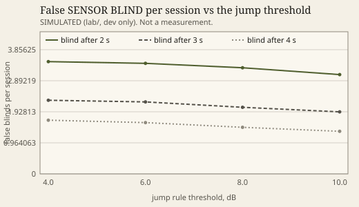
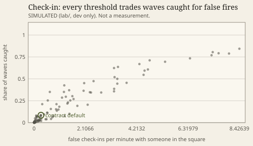
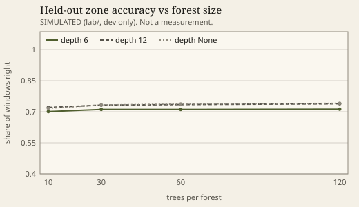
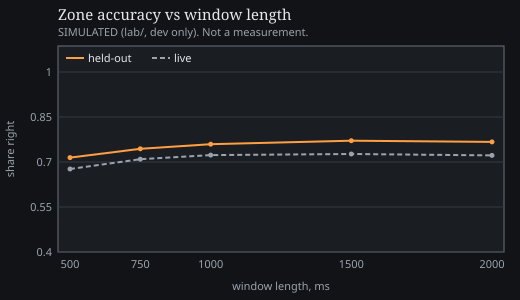

# Simulation lab report: where the brain breaks (SIMULATED)

**Every number in this file is SIMULATED.** It comes from lab/rf.py, a link model, not from the room.
None of it goes into proof.json, PROOF.md or onto the screen. It says which settings hold up and
where the brain breaks. It says nothing about real accuracy; only the hardware gates and PROOF.md do that.

## What ran

- **Code under test.**
  - main @ `070fc74`: brain/features.py, train.py, health.py and xray.py, plus advisor/advise.py.
  - brain/core.py from PR #101 @ `92e0372` (the live loop: gating, baseline, recording, training).
  - brain/alert.py from PR #113 @ `aae5805` (check-in and the no-movement alert).
  - The two PR files are loaded from their commits by lab/overlay.py, never copied.
- **Simulator** (lab/rf.py), SIMULATED:
  - knife-edge body shadowing (exact Fresnel integrals), bodies 0.3-0.5 m wide, 3-12 dB deep;
  - body reflections whose phase follows the excess path, plus Rician hall fading with factor K;
  - slow drift, BLE per-channel offsets, and readings rounded to 1 dB;
  - Wi-Fi polled at about 20/s, repeating the last frame heard;
  - phone beacons at 4-11 adverts/s with missed adverts, and the Pi beacon at about 20/s;
  - burst loss and phone slow-downs;
  - a hand wave as a moving forearm in the Wi-Fi link;
  - camera labels with missed frames, foot-point noise, clipping and latency.
- **Protocol** (lab/protocol.py): one whole deployment per session, all fed through `Brain`, `Watch` and `advise()`.
  - Setup: 20 s baseline, three training walkers standing on the marked spots (zone centres), an
    empty room, the tray recorded at T1 and at one other spot, then train.
  - Scoring: two held-out walkers.
  - Live demo with the camera unplugged:
    - a zone tour and free walking;
    - 13 s still in zone 4 (10 s limit), then a wave, then a long still stand;
    - the tray at T1, then a person beside it;
    - a 6 s and a 1.5 s beacon outage.
- **Scale.** 3,300 sessions on Modal CPUs in the 7 final stages (3,508 with early runs), with 0 errors.
  - Stages: nominal 200, wide environment 600, forest 480, window 300, protocol 960, person 560, alert 200.
  - The 800 nominal and environment sessions were also replayed through 108 check-in settings,
    36 health settings, 16 X-ray settings and 12 alert variants.
  - Modal billing showed $1.49 for these apps through the last full hour (16 session CPU-hours);
    the whole lab cost is under $2.
- **Rerun:** `python -m lab.overlay fetch`, then `modal run lab/modal_app.py --stage nominal`, then `python -m lab.analyze`.

## Read this first: limits

- **The wave is the least certain part of the model.** A forearm crossing the link mostly makes
  the link *dip*. If the real wave swings both ways, the check-in findings get better.
  - Gate 8 decides: record `pi5>unoq:wifi` during 10 waves and count the readings at least
    1.5 dB above, and at least 1.5 dB below, the 1 s median.
- **Hall fading (K) drives most results.** It is set from typical indoor numbers, not measured. Measure it in the presentation room:
  - the raw std of `pi5>unoq:wifi` over 30 s in an empty square;
  - about 0.6 dB means K ≈ 20 dB (quiet), 1.1 dB means K ≈ 15 (the nominal here), 2 dB or more means K < 10 (busy).
- **People are scripted** walkers with drawn sizes and speeds. There is one person at a time, and no crowd.
- **The ranking of failures is the useful output.** Exact percentages are not, so treat them as
  relative and look at the direction.

## Nominal room (K = 15 dB, moderate hall, default settings, 200 sessions)

| Beat | SIMULATED [95% CI] |
|---|---|
| Held-out zone accuracy (true zone) | 0.75 [0.74, 0.76] |
| ... standing within 0.15 m of a link line / over 0.3 m from every line | 0.81 / 0.43 |
| Empty room reads empty | 0.76 [0.74, 0.78] |
| Wave gives a check-in | 0.10 [0.07, 0.15] |
| False check-ins per minute, someone in the square | 0.17 [0.13, 0.21] |
| No-movement alert fires in zone 4 | 0.10 [0.07, 0.16] |
| False no-movement alerts per session | 0.02 |
| SENSOR BLIND on a 6 s beacon outage (median 4.2 s) | 1.00 [0.98, 1.00] |
| SENSOR BLIND with every beacon fine, per 4-minute demo | 0.57 (48% of sessions see one) |
| Tray alone read as object / as a person (share of decisions) | 0.30 / 0.26 |
| Person read as object | 0.02 |
| X-ray lists the tray / router advice appears | 0.01 / 0.01 |
| A still person became an X-ray object | 0.00 [0.00, 0.02] |
| Tray beat spent entirely under SENSOR BLIND | 18 of 200 sessions |

## Fragile vs robust

| Setting | Verdict (SIMULATED) | Evidence |
|---|---|---|
| Still-timer reset on one "moving" decision (alert.py) | **Fragile** | 0.11 → 0.52 alert hit with a reset only after 10 moving decisions and a majority of 10 for zone and kind |
| X-ray static steadiness, raw std < 0.8 dB (xray.py, contract) | **Fragile** | a shadowed link's raw std is 1-4 dB; tray found 0.07 at 0.8 dB, 0.33 at 1.5, 0.45 at 2.5 |
| Health jump rule, > 6 dB with kind none (health.py) | **Fragile** | fires on the tray whenever the classifier says "none"; 46% of nominal sessions get a jump blind |
| Check-in thresholds (±dB, count, window, other-link veto) | **Fragile** (no good setting) | best is 0.19 of waves at 0.41 false/min; 0.75 of waves costs 8.2 false/min |
| Training stand time on each marked spot | **Fragile** | 1 s: alert 0.00, zone 0.65; 10 s: alert 0.25, zone 0.81 |
| Training walkers | Moderately fragile | 1: 0.61, 3: 0.74, 5: 0.79 held-out zone |
| Where people stand (distance from the zone centre) | **Fragile** | ±0.05 m: 0.75; ±0.25 m: 0.66; ±0.4 m: 0.56 |
| Tray placement vs where it was trained | **Fragile** | tray read as object 0.46 at T1, 0.19 at 0.2 m off |
| Camera view beyond the square, during the baseline | **Fragile** | 0.6 m: all train; 1.0 m: 47% never finish the baseline |
| Forest size and depth (10-120 trees, depth 6-none) | Robust | held-out 0.70-0.74, all overlapping |
| Window length 1.0 s (contract) | Robust for zones | 0.71 (0.5 s) to 0.77 (2 s); longer windows only help the alert |
| X-ray alpha (0.03-1.0 x mean row energy) | Robust | identical object and advice results |
| Stale fraction 0.3-0.5 | Robust | outage caught 1.00 everywhere |
| Wi-Fi frames heard per second (8-80) | Robust | no correlation with any outcome |
| Walking speed 0.4-1.6 m/s, height ≥ 1.3 m | Robust | held-out 0.69-0.77; a 1.1 m child drops to 0.64 |
| Body depth on a link | **Fragile** below 6 dB | 3 dB: 0.44; 6 dB: 0.70; 12 dB: 0.81 |

## Recommended defaults (confidence)

1. **No-movement alert: smooth before the timer** (medium-high).
   - Reset the still timer only after 5-10 "moving" decisions in a row.
   - Take zone and kind as the majority of the last 10 decisions.
   - Nominal result: 0.11 → 0.36 (N 5) or 0.52 (N 10), with false alerts ≤ 0.04 per session.
   - With 10 s training stands as well: 0.68.
2. **Training: stand 10 s on each marked spot, with at least 3 walkers** (medium-high).
3. **X-ray static: loosen the raw 0.8 dB test** (medium).
   - Use the std of 0.5 s means (as features.steady_drop does), or raw std < 1.5 dB.
   - Expect ghost objects to linger 15-25 s after removal.
   - A missed person becomes an object in 4-8% of sessions instead of 1%. That is a contract change (section 6).
4. **Jump rule: skip a link that holds a steady drop** (an object), or raise it to 10 dB and blind after 4 s (medium).
   - The 10 dB / 4 s version cuts false blinds from 2.23 to 1.32 per session; the jump share falls from 0.78 to 0.18.
   - It costs 1 s of latency (4.0 → 4.9 s), and the 6 s outage is still always caught.
5. **Keep the forest (60 trees, depth 12), the 1.0 s window, alpha and the stale fraction as they are** (high).
6. **Check-in: keep 1.5 dB / 4 / 2.5 s until gate 8 measures a real wave** (low).
   - In simulation, no setting both catches waves and stays quiet.
   - Wave with the hand about 0.35 m from the router-receiver line: best of 0.2-0.8 m, 0.23 vs 0.10 at 0.5 m.

## When each demo beat fails (SIMULATED conditions)

- **Zones.** Accuracy falls with hall fading: 0.26 at K 3-6 dB, 0.47 at K 9-12, 0.64 at K 18-21.
  - Slow drift above 2 dB costs another 0.2 (0.62 → 0.40).
  - A judge standing over 0.3 m from every link line (the zone corners) is right 0.43 of the time.
- **Empty room.** It reads empty only 0.50 of the time once drift exceeds 2 dB (0.73 below 0.5 dB).
  A ghost person in an empty square is the most visible symptom.
- **No-movement alert.** It fails whenever any one decision in 10 s flips motion, zone or kind.
  - With the rule as written: 0.00 at K < 9 dB and at most 0.09 even at K 18-21.
- **Check-in.**
  - It false-fires above about 0.35 body-reflection strength: 0.79/min vs 0.18/min at 0.05-0.15.
  - It misses almost every wave when the hand blocks less than 3 dB: 0.02 caught.
- **Tray as object.** Read as object 0.00 at K < 6 dB, 0.27 at K 15-18 and 0.51 at K 21-25. It is read as a person 0.24-0.40 of the time.
- **X-ray tray and advice.** At the contract's 0.8 dB, the tray is found at most 0.25 of the time, even at K 21-25.
  When advice does appear, it picks a right spot 0.86-0.96 of the time, so the advisor is not the bottleneck.
- **SENSOR BLIND false alarms.**
  - They rise with interference burst length: 1.83 per session for bursts under 0.6 s, 3.99 at 1.4-2 s.
  - They also rise with phone slow-downs: 2.04 → 3.41 per session from 0 to 0.5 slow-downs a minute.
  - In a busy hall they come mostly from the jump rule: 1.49 per session at K 3-6 vs 0.40 at K 21-25.
- **Baseline.** It never completes when people stand inside the camera's view: 47% of sessions when it sees 1.0 m past the square.

## Ten most likely live-demo failures, ranked (SIMULATED)

1. **The no-movement alert never fires.** One flicker resets the 10 s timer (nominal 0.10).
2. **The wave gives no check-in**, while normal walking sometimes gives one (0.10 caught, 0.17 false/min).
3. **The tray never shows on the X-ray, so no advice.** A shadowed link is never "steady" under 0.8 dB raw std (nominal 0.01).
4. **SENSOR BLIND during the tray beat.** The jump rule fires when the tray reads as "none" (whole beat blind in 9% of sessions).
5. **The tray reads as a person**, which also freezes the X-ray's static layer (0.26 of decisions; 0.40 in a busy hall).
6. **A ghost person in the empty square** (0.24 of empty-room decisions nominal; 0.50 once slow drift passes 2 dB).
7. **SENSOR BLIND false alarms** from interference bursts and phone slow-downs (0.57 per 4-minute demo nominal).
8. **Judges stand off the marks or in a corner.** Zone accuracy falls toward 0.43-0.56.
9. **The baseline never finishes** because people around the square are in the camera's view.
10. **Too little training** (1 s stands or 1 walker), or the tray put back off its trained spot.

## Figures (SIMULATED)

- 
- 
- 
- 
- 
- 
- 
- 
- 

Full tables: run `python -m lab.analyze` (writes lab/out/tables.md; lab/out/ is git-ignored).
